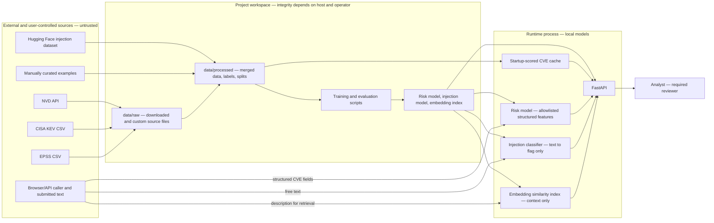

# VulnDetect Threat Model

**Status:** implementation review of the current project scaffold and code
**Scope:** ingestion, local dataset preparation, model training/inference, API, and the browser UI
**Security posture:** decision support only. Scores and classifier outputs are not verified ground truth and must not trigger automatic actions.

## System and trust boundaries

All vulnerability descriptions, asset-owner fields, advisories, and other imported text are untrusted data, even when received from a normally authoritative source. Source reputation does not make text safe to interpret as instructions.

**Trust boundaries:** external feeds and submitted text cross into local files or the API; downloaded/curated data becomes training input; trained artifacts are loaded into the API; API responses cross back to the browser and analyst. HTTPS protects transport to configured sources, but this implementation does not cryptographically authenticate dataset contents or protect local files from a compromised host. CORS restricts browser origins for local development; it is not API authentication or authorization.

## Threat register

### T1 — Prompt injection in CVE descriptions or asset fields

**Attack description:** An attacker places instruction-like text in a CVE description, vendor advisory, ticket, or asset-owner field. They try to make an AI-backed workflow suppress a finding, change its severity, reveal data, or take an action.

**Impact:** If untrusted text were treated as instructions by a downstream model or operator, it could distort triage, conceal a vulnerability, or encourage disclosure or unsafe action.

**Mitigations implemented in this codebase:**

- [`api/risk_engine.py`](api/risk_engine.py), `RiskEngine._structured_features`, builds the risk-model input from an allowlist of structured values (`cvss_v3_score`, `epss_score`, `published_date`, `cwe_id`) and a fixed training median for description length. It does not pass `description` or `free_text_fields` into the numeric risk features.
- `RiskEngine._injection_detected` sends free-text values to the separate classifier and sets `INJECTION_DETECTED` only when class-1 confidence is greater than `0.70`. This signal sets a flag; it does not modify the model probability or deterministic rating thresholds in `RiskEngine._rating`.
- `RiskEngine.assess` always returns `requires_human_review: True`. [`tests/test_risk_engine.py`](tests/test_risk_engine.py) and [`tests/test_api.py`](tests/test_api.py) cover the invariant that flagged text does not change the structured risk result.
- [`frontend/src/App.tsx`](frontend/src/App.tsx) renders text as React content and labels the system as recommendations requiring human review.

**Not mitigated / residual risk:** The classifier is probabilistic and can miss novel, obfuscated, multilingual, or indirect instructions; it can also flag benign text. A `0.70` threshold is not a guarantee. The API has no authentication, authorization, request-size limit, or rate limit, so a caller may submit large volumes of text or ignore the flag. The flag is advisory and does not technically prevent an external consumer from acting on a response. Similarity retrieval is not an injection defense. No model can establish that every supplied field is safe.

### T2 — Poisoning of NVD, KEV, EPSS, or training inputs

**Attack description:** An upstream source, distribution path, local raw file, or manually supplied example is altered to introduce false CVE attributes, false exploitation status, or attacker-selected training examples.

**Impact:** Poisoned inputs can corrupt the merged dataset, labels, model parameters, risk ranking, and evaluation results. A sufficiently influential or persistent change can make the model favor attacker-selected outcomes while appearing to train normally.

**Mitigations implemented in this codebase:**

- [`ingestion/fetch_nvd.py`](ingestion/fetch_nvd.py), [`ingestion/fetch_kev.py`](ingestion/fetch_kev.py), and [`ingestion/fetch_epss.py`](ingestion/fetch_epss.py) use HTTPS, request timeouts, and HTTP status checks; the NVD fetcher handles pagination and retries rate-limit/server responses.
- [`ingestion/build_dataset.py`](ingestion/build_dataset.py) validates expected source columns and parses CVE identifiers and score values into an explicit schema. [`models/injection_classifier/prepare_data.py`](models/injection_classifier/prepare_data.py) normalizes labels and removes exact normalized-text duplicates.
- [`models/build_labels.py`](models/build_labels.py) keeps KEV-derived positives distinct from EPSS-derived weak proxies through `label_type`; data files are ignored by Git except for the explicitly included custom injection CSV.

**Not mitigated / residual risk:** HTTPS authenticates the connection endpoint, not each record's correctness. There are no signed snapshots, checksums, independent source cross-checks, anomaly detection, immutable audit log, or routine human approval of feed changes. Raw and processed files can be edited locally. Parsing and schema checks do not detect plausible but false values or a compromised upstream account. The custom examples and public Hugging Face dataset also require provenance and quality review. Training currently proceeds without a poisoning-specific audit or robust-learning method.

### T3 — Adaptive evasion of the prompt-injection classifier

**Attack description:** An attacker knows the classifier was fine-tuned from `deepset/prompt-injections` plus a small, manually written set covering instruction override, authority impersonation, data exfiltration, and prompt leakage. They craft paraphrases, obfuscation, role-play, indirect instructions, or field-specific payloads that differ from those examples but retain the attack intent.

**Impact:** An evasion may avoid `INJECTION_DETECTED`, leaving a human or downstream component unaware that a field contains adversarial instructions. The risk score remains isolated from the text, but the missing warning can still affect human decisions or other integrations.

**Mitigations implemented in this codebase:**

- [`models/injection_classifier/prepare_data.py`](models/injection_classifier/prepare_data.py) combines the public dataset with 20 custom malicious and 20 benign examples, deduplicates text, and makes stratified train/validation/test splits.
- [`models/injection_classifier/train_classifier.py`](models/injection_classifier/train_classifier.py) fine-tunes DistilBERT, selects the checkpoint using validation F1, and uses early stopping. [`models/injection_classifier/evaluate_classifier.py`](models/injection_classifier/evaluate_classifier.py) compares it with a regex baseline on a held-out split.
- [`api/risk_engine.py`](api/risk_engine.py), `RiskEngine._structured_features`, preserves score isolation even if injection detection fails.

**Not mitigated / residual risk:** Random stratification is not an adversarial, temporal, or source-separated evaluation. The custom sample is small and cannot cover the attack space. There is no red-team corpus, paraphrase/obfuscation augmentation, calibration study, drift monitoring, or periodic retraining workflow. Knowing the training categories can help an attacker avoid their surface patterns. The classifier's confidence is not a probability that text is safe, and a negative result must not be interpreted as proof of benign content.

### T4 — Over-reliance on a risk rating as ground truth

**Attack description:** An analyst, product, or integration treats `LOW`, `MEDIUM`, `HIGH`, `CRITICAL`, or the numeric model output as a verified fact and skips independent triage or remediation review.

**Impact:** A false low rating can delay mitigation; a false high rating can waste response capacity or cause unnecessary disruption. Repeated over-trust can turn an advisory model into an unreviewed decision-maker.

**Mitigations implemented in this codebase:**

- [`api/risk_engine.py`](api/risk_engine.py), `RiskEngine._rating`, maps the model probability through fixed documented thresholds (`0.75`, `0.50`, `0.25`); injection flags and similarity results do not override the thresholds.
- `RiskEngine.assess` always returns `requires_human_review: True`; the frontend footer states that assessments are recommendations and requires human review.
- [`models/train_risk_model_ablation.py`](models/train_risk_model_ablation.py) evaluates the two matched primary models against CVSS-only, EPSS-only, and random baselines; proxy labels are excluded from this primary evaluation.

**Not mitigated / residual risk:** The API does not enforce an approval workflow, identity check, or block automatic downstream actions. A caller can ignore `requires_human_review`. The rating cutoffs are fixed portfolio choices, not thresholds validated against operational loss or calibrated to a real-world event rate. Feature contributions are explanatory summaries, not causal explanations. Human review quality, reviewer training, and escalation policy are outside this repository.

### T5 — Weak-proxy labels and misleading model confidence

**Attack description:** Model users interpret KEV membership labels, probabilities, or evaluation scores as a complete, independently verified ground truth for exploitation, or conflate supplementary EPSS-threshold proxy results with primary performance.

**Impact:** The model can learn the labeling rule rather than real exploitation. This can inflate apparent performance, bias feature importance toward EPSS, and produce numerical scores that look calibrated while not representing a true probability of exploitation. A relative ordering may still be useful for prioritization, but it is only a hypothesis until evaluated against independent outcomes.

**Mitigations implemented in this codebase:**

- [`models/build_labels.py`](models/build_labels.py) creates a primary balanced cohort for KEV membership (`in_kev`, `label_type=strong`) and a separate `weak_proxy_sample.parquet` cohort based on EPSS thresholds. Non-membership means absent from the catalog snapshot, not confirmed never exploited.
- [`models/train_risk_model_ablation.py`](models/train_risk_model_ablation.py) trains two models against the same KEV-membership holdout, including a variant without `epss_score` or its interaction. It excludes the weak-proxy cohort from primary training and records this separation in the evaluation JSON/report.
- [`results/risk_model_report.md`](results/risk_model_report.md) documents the limitation before training and is populated by the training script after a run.

**Not mitigated / residual risk:** KEV membership is a catalog proxy with coverage and timing limits; CVEs absent from KEV can still have been exploited. The with-EPSS model may rely heavily on EPSS, while the no-EPSS comparison only tests this sample and split. No probability calibration, temporal holdout, or independent exploitation outcome is implemented. EPSS-threshold proxy analysis remains circular by design and is explicitly supplementary. Do not interpret scores as calibrated probabilities of exploitation; validate prospectively before operational reliance.

## Operational assumptions and required follow-up

- The API and model artifacts run on a trusted host with filesystem access controlled by the operator. The current FastAPI app has no authentication or authorization; do not expose it directly to an untrusted network without adding those controls.
- Keep analyst review in the decision loop. Do not use scores or flags as an automatic patch, close-ticket, suppress-alert, or access-control decision.
- Before production use, add source snapshot provenance/integrity checks, authentication and rate limiting, adversarial classifier testing, monitoring for drift, calibrated/temporal evaluation, and a separately curated set of verified exploitation outcomes.

This document describes mitigations visible in the current repository; it is not a claim that the system is secure against all prompt-injection, poisoning, evasion, or misuse attacks.
