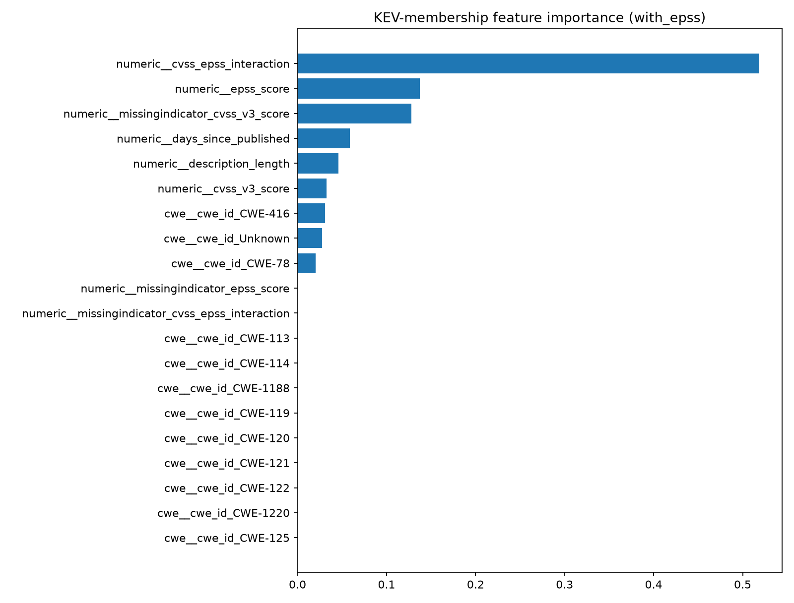
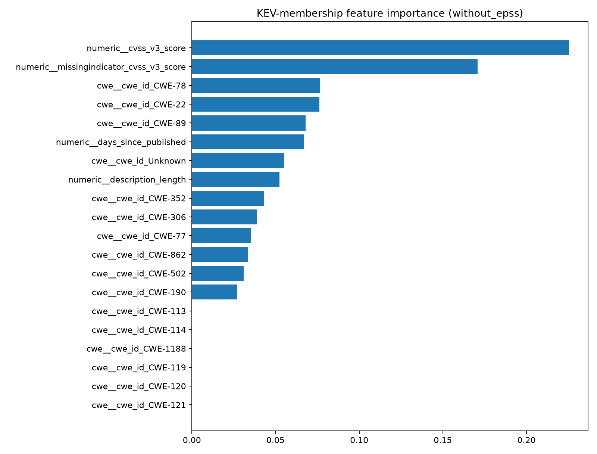

# Full Evaluation Report

Generated from saved evaluation artifacts. This report uses deterministic, human-authored interpretation templates; no external LLM is used.

## Evaluation summary

ROC-AUC is shown as AUC; PR-AUC is included when available. Risk model and baseline rows marked **same test set** are the fair, directly comparable results. A dash means the source report did not contain that metric.

## Primary KEV-membership risk evaluation

All methods in this table are evaluated on the same held-out KEV membership records. A CVE absent from KEV is not confirmed unexploited.

| Model | Precision | Recall | F1 | ROC-AUC | PR-AUC |
|---|---:|---:|---:|---:|---:|
| CVSS-only (same test set) | 0.739 | 0.850 | 0.791 | 0.840 | 0.801 |
| EPSS-only (same test set) | 0.970 | 0.533 | 0.688 | 0.920 | 0.920 |
| Random base-rate matched (same test set) | 0.533 | 0.533 | 0.533 | 0.521 | 0.532 |
| XGBoost with EPSS (same holdout) | 0.930 | 0.883 | 0.906 | 0.949 | 0.949 |
| XGBoost without EPSS (same holdout) | 0.814 | 0.800 | 0.807 | 0.872 | 0.851 |

## Injection-classifier evaluation

Both detectors use the same held-out injection test split.

| Model | Precision | Recall | F1 | ROC-AUC | PR-AUC |
|---|---:|---:|---:|---:|---:|
| Regex/keyword baseline (test set) | 1.000 | 0.023 | 0.045 | 0.512 | 0.419 |
| Trained DistilBERT (test set) | 0.974 | 0.884 | 0.927 | 0.997 | 0.995 |


### Full-cohort baseline references from `baseline_results.json`

These scores use the full balanced primary cohort. They are included for traceability only and must not be compared directly with model holdout scores.

| Task | Baseline | Precision | Recall | F1 | ROC-AUC | PR-AUC |
|---|---|---:|---:|---:|---:|---:|
| Risk scorer (full balanced cohort) | CVSS-only | 0.689 | 0.880 | 0.773 | 0.814 | — |
| Risk scorer (full balanced cohort) | EPSS-only | 0.974 | 0.500 | 0.661 | 0.940 | — |
| Risk scorer (full balanced cohort) | Random base-rate matched | 0.510 | 0.510 | 0.510 | 0.490 | — |


## Supplementary weak-proxy analysis (not primary)

These metrics use a separate cohort whose labels are defined by EPSS thresholds. The EPSS baseline is therefore circular by construction. These results are exploratory and are excluded from all primary model metrics.

| Task | Method | Precision | Recall | F1 | ROC-AUC | PR-AUC |
|---|---|---:|---:|---:|---:|---:|
| Weak-proxy (exploratory only) | CVSS-only | 0.613 | 0.560 | 0.585 | 0.588 | — |
| Weak-proxy (exploratory only) | EPSS-only (label-defining signal) | 1.000 | 1.000 | 1.000 | 1.000 | — |
| Weak-proxy (exploratory only) | Random base-rate matched | 0.503 | 0.503 | 0.503 | 0.500 | — |


## Risk-model feature importance





Feature importance describes how the fitted model used features for this labeled dataset; it is not a causal explanation of exploitation risk.

## Interpretation

On the recorded comparable split, the trained KEV-membership risk-scoring model's F1 is higher by 0.115 than cvss_only (0.906 vs 0.791). With EPSS, F1 is 0.906; without EPSS, it is 0.807 (difference +0.099) on the same KEV-membership holdout. On the recorded comparable split, the trained prompt-injection model's F1 is higher by 0.881 than regex/keyword baseline (0.927 vs 0.045). The primary risk target is CISA KEV catalog membership; not being listed is not proof of non-exploitation. These comparisons do not establish prediction of all independently verified real-world exploitation. Treat probability values as scores until independent, representative validation and calibration are completed. The primary table uses the baseline scores from the risk evaluation's same holdout. `baseline_results.json` is used below for separate full-cohort references and supplementary proxy analysis.

## Limitations

- **Dataset size:** Risk model holdout: 120 examples. Injection-classifier test split: 106 examples. These are small portfolio-scale datasets; estimates can move materially with a different split or a few changed examples. Stratified random splits do not test future-time generalization.
- **Primary label scope:** Primary metrics predict KEV catalog membership only. KEV entries are evidence of known exploitation, but CVEs not listed in the sampled catalog are not confirmed unexploited; catalog coverage and timing matter. The balanced sample also does not represent real-world prevalence.
- **Supplementary weak-proxy labels:** EPSS-threshold labels are kept in `weak_proxy_sample.parquet` and are not included in primary training or primary reported metrics. Any supplementary performance is exploratory and circular with EPSS because EPSS defines those labels.
- **EPSS ablation:** Primary evaluation compares models with and without `epss_score` (and its interaction feature) on the same KEV-membership holdout. This tests incremental predictive value for this sample; it does not establish causality or future-time generalization. Absolute risk probabilities are not calibrated exploitation likelihoods.
- **Synthetic injection examples:** The custom injection file contains 20 hand-written malicious and 20 hand-written benign vulnerability-management examples. They are useful seed examples but are synthetic, narrow, and may not represent real field distributions or adaptive attacks. Their presence in random stratified splits can make evaluation optimistic for similar wording.
- **Injection training size and overfitting:** The injection classifier was trained on 491 examples. Training loss fell to approximately 0.01 while validation loss plateaued around 0.25–0.29, suggesting mild overfitting. The strong held-out metrics should be treated cautiously and confirmed on a larger, independently collected set.
- **Base-rate mismatch:** The KEV evaluation sample is class-balanced (50% positive in the saved holdout), unlike the approximately 0.4% real-world KEV base rate cited for this project. Precision and other threshold-dependent metrics from the balanced sample will not carry over directly to a production population with that prevalence.
- **Metric availability:** The report does not infer missing AUC values from precision/recall/F1. If an older injection evaluation file lacks ROC-AUC or PR-AUC, rerun `models/injection_classifier/evaluate_classifier.py` to populate them.

## Input artifact status

- loaded: results/baseline_results.json
- loaded: results/risk_model_evaluation.json
- loaded: results/injection_classifier_evaluation.json

## Reproducing this report

Run the baseline, risk-model, and injection-classifier evaluation scripts to create the three JSON inputs, then run:

```bash
python scripts/generate_evaluation_report.py
```
